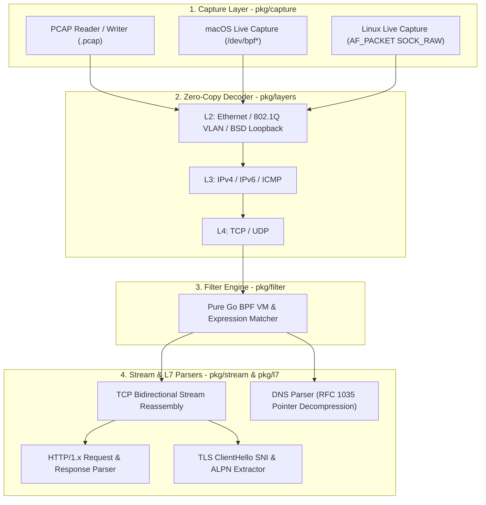

# GoPcap

<p align="center">
  <b>Pure Go, Zero-CGO, Zero-Copy Network Packet Capture & Protocol Analysis Library</b>
  <br/>
  <a href="./README.md">English</a> | <a href="./README_CN.md">简体中文</a>
</p>

<p align="center">
  
  
  
  
  
</p>

---

**GoPcap** is a pure Go (`CGO_ENABLED=0`), zero-dependency network packet capture and protocol analysis toolkit. Unlike traditional libraries that wrap `libpcap` via CGO, GoPcap interacts directly with OS kernel interfaces (macOS `/dev/bpf*` and Linux `AF_PACKET` raw sockets), enabling effortless cross-compilation into static binaries while delivering ~47M+ packets/sec zero-allocation L2–L4 decoding, TCP stream reassembly, and L7 protocol inspection.

---

## Features

- **100% Pure Go & Zero External Dependencies**: Built strictly on the Go standard library (`syscall`, `net/netip`, `encoding/binary`). Cross-compile from any host with `CGO_ENABLED=0`.
- **Cross-Platform Live Capture**:
  - **macOS / BSD**: Native `/dev/bpf*` interface binding (`BIOCSETIF`), immediate mode (`BIOCIMMEDIATE`), promiscuous mode (`BIOCPROMISC`), and multi-frame buffer alignment.
  - **Linux**: Native `AF_PACKET` (`SOCK_RAW`) socket capture with `SockaddrLinklayer` interface binding and `PACKET_MR_PROMISC` support.
- **Standard PCAP Read & Write**: Stream reader and writer for `.pcap` files supporting both Little-Endian and Big-Endian byte orders, as well as microsecond and nanosecond timestamp resolutions.
- **Zero-Copy L2–L4 Decoding (`0 allocs/op`)**:
  - Reuses `DecodedPacket` structs and allocation-free `netip.Addr` value types, slicing directly into the packet buffer (~20.9 ns/op, `0 B/op`, `0 allocs/op`).
  - Supports **Ethernet II**, **802.1Q VLAN (including QinQ)**, **BSD Loopback (`lo0`)**, **IPv4**, **IPv6 (with extension header skipping)**, **TCP**, **UDP**, and **ICMPv4/v6**.
- **Bidirectional TCP Stream Reassembly**:
  - Tracks bidirectional sessions using a canonical 4-tuple `FlowKey`.
  - Handles out-of-order segment buffering, retransmission deduplication, and overlapping byte trimming.
- **L7 Application Protocol Parsers**:
  - **HTTP/1.x**: Port-independent detection and parsing of HTTP requests and responses (Method, URI, Host, StatusCode, Headers, Body preview).
  - **TLS**: Parses TLS Handshake `ClientHello` records to extract **SNI (Server Name Indication)**, **ALPN**, and CipherSuites.
  - **DNS**: Full RFC 1035 parser with recursive `0xC0` pointer decompression and loop protection.
- **Packet Filtering Engine**:
  - Includes a pure-Go Classic BPF Virtual Machine (`BPFVM`) and a human-readable filter compiler supporting both L2–L4 (`tcp`, `udp`, `icmp`, `host`, `port`) and L7 (`http`, `tls`, `dns`) primitives.

---

## Architecture



---

## Project Layout

```text
GoPcap/
├── cmd/
│   └── gopcap/
│       └── main.go              # CLI packet capture and analysis tool
├── pkg/
│   ├── capture/
│   │   ├── capture.go           # Unified PacketSource interface & device enumeration
│   │   ├── live_darwin.go       # macOS /dev/bpf* pure-Go live capture
│   │   ├── live_linux.go        # Linux AF_PACKET pure-Go live capture
│   │   ├── live_other.go        # Fallback stub for unsupported OS
│   │   ├── pcap_reader.go       # Standard .pcap reader (LE/BE, us/ns)
│   │   ├── pcap_writer.go       # Standard .pcap writer
│   │   └── pcap_test.go         # PCAP I/O unit tests
│   ├── layers/
│   │   ├── layers.go            # Reusable DecodedPacket & zero-copy pipeline
│   │   ├── ethernet.go          # Ethernet II / 802.1Q VLAN / BSD Loopback
│   │   ├── ipv4.go              # IPv4 header decoder
│   │   ├── ipv6.go              # IPv6 header & extension header decoder
│   │   ├── tcp.go               # TCP header, flags & options decoder
│   │   ├── udp.go               # UDP header decoder
│   │   ├── icmp.go              # ICMPv4 / ICMPv6 decoder
│   │   └── layers_test.go       # Decoder unit tests & zero-copy benchmarks
│   ├── filter/
│   │   ├── bpf.go               # Classic BPF VM & filter expression compiler
│   │   └── bpf_test.go          # Filter unit tests
│   ├── stream/
│   │   ├── reassembly.go        # TCP 4-tuple flow tracker & stream reassembler
│   │   └── reassembly_test.go   # Out-of-order & overlap reassembly tests
│   └── l7/
│       ├── dns.go               # DNS message parser & pointer decompression
│       ├── http.go              # HTTP/1.x request & response parser
│       ├── tls.go               # TLS ClientHello SNI & ALPN parser
│       └── l7_test.go           # L7 parser unit tests
├── README.md                    # English documentation
├── README_CN.md                 # Chinese documentation
└── go.mod
```

---

## Quick Start

### 1. Build from Source

```bash
# Build native static binary
CGO_ENABLED=0 go build -o bin/gopcap ./cmd/gopcap

# Cross-compile for Linux AMD64 from macOS/Windows
GOOS=linux GOARCH=amd64 CGO_ENABLED=0 go build -o bin/gopcap-linux-amd64 ./cmd/gopcap
```

### 2. CLI Usage

```text
Usage of gopcap:
  -list            List all available network interfaces
  -i string        Network interface for live capture (default "en0")
  -r string        Read packets from an offline .pcap file
  -w string        Write captured/matched packets to a .pcap file
  -f string        Packet filter expression (e.g. "http", "tcp and port 443")
  -c int           Stop after capturing N matching packets (0 = unlimited)
  -s int           SnapLen: maximum bytes per packet (default 65535)
  -promisc         Enable promiscuous mode on live interface
  -gen-demo string Generate a sample multi-protocol .pcap file and exit
```

### 3. Examples

#### List Network Interfaces
```bash
./bin/gopcap -list
```

#### Generate & Analyze a Sample Multi-Protocol PCAP (No Root Required)
```bash
./bin/gopcap -gen-demo demo.pcap
./bin/gopcap -r demo.pcap
```
Output:
```text
Reading from PCAP file demo.pcap (LinkType: ETHERNET)
#1    23:30:00.000000 UDP  192.168.1.10:54321 -> 8.8.8.8:53 len=29
    [L7 UDP] DNS Query id=0x1234 A example.com
#2    23:30:00.010000 TCP  192.168.1.10:55000 -> 93.184.216.34:80 [ACK,PSH] seq=1000 ack=1 len=71
    [L7 Stream C->S 192.168.1.10:55000->93.184.216.34:80] HTTP GET /status (Host: api.example.com)
#3    23:30:00.020000 TCP  192.168.1.10:55001 -> 93.184.216.34:443 [ACK,PSH] seq=2000 ack=1 len=88
    [L7 Stream C->S 192.168.1.10:55001->93.184.216.34:443] TLS ClientHello ver=TLS 1.2 SNI=secure.example.com ALPN=h2 ciphers=1
Done. Total matched packets: 3 (Active TCP flows tracked: 2)
```

#### Filter Offline PCAP by L7 Protocol or Host
```bash
# Filter HTTP traffic across any port (including non-standard ports like 8080)
./bin/gopcap -r capture.pcap -f "http" -c 20

# Combine L7 protocol and IP host filters
./bin/gopcap -r capture.pcap -f "http and src host 192.168.1.10"
```

#### Live Interface Capture
> Note: Accessing `/dev/bpf*` on macOS or `AF_PACKET` on Linux requires `sudo` or `CAP_NET_RAW`.
```bash
sudo ./bin/gopcap -i en0 -f "tcp and port 443" -w tls_capture.pcap -c 100
```

---

## Filter Syntax (`-f`)

Clauses can be combined with `and` or `&&`:

| Category | Primitives / Examples | Description |
| :--- | :--- | :--- |
| **L2/L3/L4 Protocol** | `tcp`, `udp`, `icmp`, `icmp6`, `ip` (`ipv4`), `ip6` (`ipv6`), `arp` | Match by link, network, or transport layer protocol |
| **L7 Protocol** | `http`, `tls` (`https`, `ssl`), `dns` | Payload-aware application protocol matching (port-independent for HTTP/TLS) |
| **IP / Host** | `host 10.0.0.1`, `src host 10.0.0.1`, `dst host 10.0.0.2` | Match source and/or destination IPv4/IPv6 address |
| **Port** | `port 80`, `src port 54321`, `dst port 443` | Match source and/or destination TCP/UDP port |

---

## SDK Usage Example

```go
package main

import (
	"fmt"
	"io"

	"github.com/gopcap/gopcap/pkg/capture"
	"github.com/gopcap/gopcap/pkg/l7"
	"github.com/gopcap/gopcap/pkg/layers"
	"github.com/gopcap/gopcap/pkg/stream"
)

func main() {
	// 1. Open an offline PCAP file (or use capture.OpenLive for live interface capture)
	src, err := capture.OpenPcapFile("demo.pcap")
	if err != nil {
		panic(err)
	}
	defer src.Close()

	// 2. Initialize TCP stream reassembler with L7 protocol callbacks
	assembler := stream.NewTCPAssembler(func(ev stream.StreamEvent) {
		if httpMsg, err := l7.ParseHTTP(ev.StreamBuffer); err == nil {
			fmt.Printf("[%s -> %s] %s\n", ev.Client, ev.Server, httpMsg.Summary())
		} else if tlsCH, err := l7.ParseTLSClientHello(ev.StreamBuffer); err == nil {
			fmt.Printf("[%s -> %s] %s\n", ev.Client, ev.Server, tlsCH.Summary())
		}
	})

	// 3. Reuse a single DecodedPacket instance for zero-allocation decoding
	var pkt layers.DecodedPacket
	for {
		raw, err := src.NextPacket()
		if err == io.EOF {
			break
		}
		if err != nil {
			panic(err)
		}

		if err := layers.DecodePacket(raw, &pkt); err != nil {
			continue
		}

		if pkt.HasTCP {
			assembler.ProcessPacket(&pkt)
		}
	}
}
```

---

## Testing & Benchmarks

```bash
# Run all unit tests
CGO_ENABLED=0 go test -v ./...

# Run zero-copy L2-L4 decoder benchmark
CGO_ENABLED=0 go test -bench=BenchmarkZeroCopyDecode -benchmem ./pkg/layers
```

Benchmark output:
```text
BenchmarkZeroCopyDecode-10    	56657779	        20.93 ns/op	       0 B/op	       0 allocs/op
```

---

## License

Released under the [MIT License](https://opensource.org/licenses/MIT).
