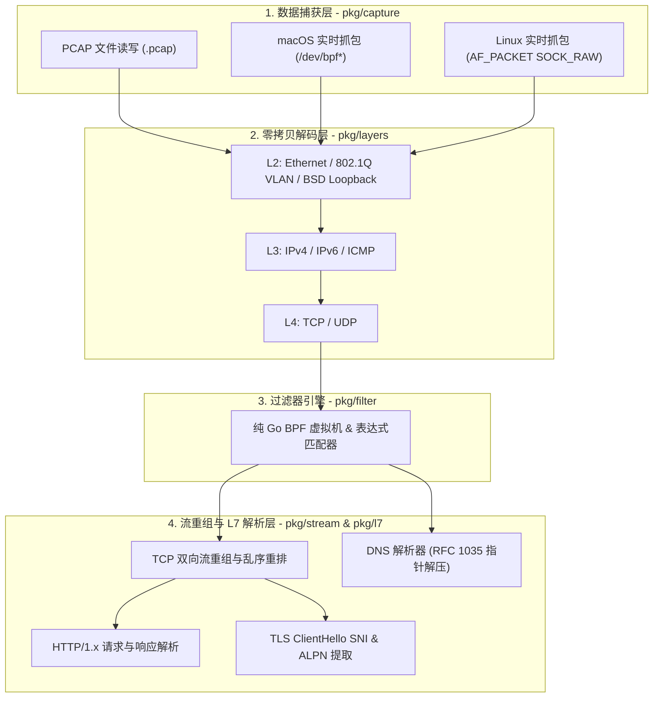

# GoPcap

<p align="center">
  <b>纯 Go 实现、零 CGO 依赖、零拷贝的网络抓包与协议分析库</b>
  <br/>
  <a href="./README.md">English</a> | <a href="./README_CN.md">简体中文</a>
</p>

<p align="center">
  
  
  
  
  
</p>

---

**GoPcap** 是一个基于纯 Go（`CGO_ENABLED=0`、**零第三方依赖**）实现的跨平台网络抓包与协议分析库及命令行工具。不同于传统通过 CGO 绑定 `libpcap` 动态库的方案，GoPcap 直接调用操作系统底层内核接口（macOS `/dev/bpf*` 与 Linux `AF_PACKET` 原始套接字），支持一键交叉编译为静态单文件二进制，并提供单核 ~4700 万包/秒的零内存分配 L2–L4 解码、TCP 双向流重组以及 L7 应用层协议（DNS / HTTP / TLS）解析能力。

---

## 核心特性

- **100% 纯 Go & 零外部依赖**：完全基于 Go 标准库（`syscall`、`net/netip`、`encoding/binary`）构建，使用 `CGO_ENABLED=0` 即可轻松跨平台静态编译。
- **跨平台实时网卡抓包**：
  - **macOS / BSD**：直接驱动内核 `/dev/bpf*` 设备（支持 `BIOCSETIF` 绑定网卡、`BIOCIMMEDIATE` 即时模式、`BIOCPROMISC` 混杂模式及多帧对齐切分）。
  - **Linux**：直接通过 `AF_PACKET` (`SOCK_RAW`) 原始套接字与 `SockaddrLinklayer` 抓取链路层帧。
- **标准 PCAP 离线读写**：流式读取与写入标准 `.pcap` 文件，自动识别大端/小端字节序以及微秒/纳秒时间戳精度。
- **零拷贝 L2–L4 协议解码（`0 allocs/op`）**：
  - 复用 `DecodedPacket` 结构体与无堆分配的 `netip.Addr` 值类型，直接在原始字节切片上解码（约 `20.9 ns/op`，`0 B/op`，`0 allocs/op`）。
  - 支持 **Ethernet II**、**802.1Q VLAN（含 QinQ）**、**BSD Loopback (`lo0`)**、**IPv4**、**IPv6（含扩展头跳过）**、**TCP**、**UDP**、**ICMPv4/v6**。
- **TCP 双向流重组引擎**：
  - 基于规范化四元组（Canonical `FlowKey`）跟踪双向会话。
  - 自动处理 TCP 乱序包缓存重排、重传包去重、部分重叠分片（Overlap）裁剪。
- **L7 应用层协议识别与解析**：
  - **HTTP/1.x**：不局限于默认端口（支持任意非标端口如 `8080`），自动识别并解析 HTTP 请求与响应（Method、URI、Host、StatusCode、Headers、Body 预览）。
  - **TLS**：解析 TLS Handshake `ClientHello`，提取 **SNI (Server Name Indication)**、**ALPN** 与加密套件列表。
  - **DNS**：完整实现 RFC 1035 报文解析及 `0xC0` 域名压缩指针递归解压（内置环路保护）。
- **灵活的过滤器引擎**：
  - 内置纯 Go 经典 BPF 字节码虚拟机（`BPFVM`）。
  - 支持同时组合 L2–L4（`tcp`、`udp`、`icmp`、`port`、`host`）与 L7（`http`、`tls`、`dns`）的可读过滤表达式。

---

## 架构设计



---

## 目录结构

```text
GoPcap/
├── cmd/
│   └── gopcap/
│       └── main.go              # 命令行抓包与协议分析工具
├── pkg/
│   ├── capture/
│   │   ├── capture.go           # PacketSource 统一接口与网卡列表枚举
│   │   ├── live_darwin.go       # macOS /dev/bpf* 纯 Go 实时抓包实现
│   │   ├── live_linux.go        # Linux AF_PACKET 纯 Go 实时抓包实现
│   │   ├── live_other.go        # 其他平台兜底桩
│   │   ├── pcap_reader.go       # 标准 .pcap 文件读取器（支持微秒/纳秒、大端/小端）
│   │   ├── pcap_writer.go       # 标准 .pcap 文件写入器
│   │   └── pcap_test.go         # PCAP 读写单元测试
│   ├── layers/
│   │   ├── layers.go            # DecodedPacket 零拷贝解码流水线
│   │   ├── ethernet.go          # Ethernet II / 802.1Q VLAN / BSD Loopback
│   │   ├── ipv4.go              # IPv4 头部解析
│   │   ├── ipv6.go              # IPv6 头部与扩展头解析
│   │   ├── tcp.go               # TCP 头部、Flags 与 Options 解析
│   │   ├── udp.go               # UDP 头部解析
│   │   ├── icmp.go              # ICMPv4 / ICMPv6 解析
│   │   └── layers_test.go       # 协议解码单元测试与 Zero-Copy Benchmark
│   ├── filter/
│   │   ├── bpf.go               # 纯 Go BPF 虚拟机与过滤表达式编译器
│   │   └── bpf_test.go          # 过滤器单元测试
│   ├── stream/
│   │   ├── reassembly.go        # TCP 四元组会话跟踪与乱序/重叠流重组引擎
│   │   └── reassembly_test.go   # TCP 流重组单元测试
│   └── l7/
│       ├── dns.go               # DNS 报文解析与域名压缩指针解压
│       ├── http.go              # HTTP/1.x 请求与响应解析
│       ├── tls.go               # TLS ClientHello / SNI / ALPN 解析
│       └── l7_test.go           # L7 协议解析单元测试
├── README.md                    # 英文文档 (English)
├── README_CN.md                 # 中文文档 (简体中文)
└── go.mod
```

---

## 快速开始

### 1. 编译命令行工具

```bash
# 本地纯 Go 静态编译
CGO_ENABLED=0 go build -o bin/gopcap ./cmd/gopcap

# 交叉编译 Linux AMD64 静态二进制文件
GOOS=linux GOARCH=amd64 CGO_ENABLED=0 go build -o bin/gopcap-linux-amd64 ./cmd/gopcap
```

### 2. 命令行参数说明

```text
Usage of gopcap:
  -list            列出本机所有可用网卡接口信息
  -i string        指定实时抓包网卡名称 (默认 "en0")
  -r string        从离线 .pcap 文件读取并分析流量
  -w string        将捕获/过滤后的数据包写入目标 .pcap 文件
  -f string        过滤表达式 (例如 "http", "tcp and port 443", "udp and port 53")
  -c int           捕获匹配指定数量的数据包后自动停止 (0 表示不限制)
  -s int           SnapLen 每个数据包最大捕获字节数 (默认 65535)
  -promisc         开启网卡混杂模式 (Promiscuous Mode)
  -gen-demo string 生成包含 DNS/HTTP/TLS 的示例 .pcap 文件并退出
```

### 3. 使用示例

#### 列出本机所有网卡
```bash
./bin/gopcap -list
```

#### 生成多协议示例 PCAP 并离线分析（无需 root 权限）
```bash
./bin/gopcap -gen-demo demo.pcap
./bin/gopcap -r demo.pcap
```
输出示例：
```text
Reading from PCAP file demo.pcap (LinkType: ETHERNET)
#1    23:30:00.000000 UDP  192.168.1.10:54321 -> 8.8.8.8:53 len=29
    [L7 UDP] DNS Query id=0x1234 A example.com
#2    23:30:00.010000 TCP  192.168.1.10:55000 -> 93.184.216.34:80 [ACK,PSH] seq=1000 ack=1 len=71
    [L7 Stream C->S 192.168.1.10:55000->93.184.216.34:80] HTTP GET /status (Host: api.example.com)
#3    23:30:00.020000 TCP  192.168.1.10:55001 -> 93.184.216.34:443 [ACK,PSH] seq=2000 ack=1 len=88
    [L7 Stream C->S 192.168.1.10:55001->93.184.216.34:443] TLS ClientHello ver=TLS 1.2 SNI=secure.example.com ALPN=h2 ciphers=1
Done. Total matched packets: 3 (Active TCP flows tracked: 2)
```

#### 按 L7 协议或 IP 过滤离线 `.pcap` 文件
```bash
# 过滤所有 HTTP 报文（支持识别任意非标端口上的 HTTP 流量）
./bin/gopcap -r capture.pcap -f "http" -c 20

# 组合协议与源 IP 地址过滤
./bin/gopcap -r capture.pcap -f "http and src host 192.168.1.10"
```

#### 实时网卡抓包并保存为 `.pcap` 文件
> 注：macOS 访问 `/dev/bpf*` 或 Linux 创建 `AF_PACKET` 原始套接字需要 `sudo` 或 `CAP_NET_RAW` 权限。
```bash
sudo ./bin/gopcap -i en0 -f "tcp and port 443" -w tls_capture.pcap -c 100
```

---

## 过滤表达式语法 (`-f`)

支持使用 `and` 或 `&&` 组合多个过滤条件：

| 类别 | 语法原语 / 示例 | 说明 |
| :--- | :--- | :--- |
| **L2/L3/L4 协议** | `tcp`, `udp`, `icmp`, `icmp6`, `ip` (`ipv4`), `ip6` (`ipv6`), `arp` | 匹配链路层、网络层或传输层协议 |
| **L7 应用层协议** | `http`, `tls` (`https`, `ssl`), `dns` | 基于载荷特征识别应用层协议（不局限于固定端口） |
| **IP / 主机地址** | `host 10.0.0.1`, `src host 10.0.0.1`, `dst host 10.0.0.2` | 匹配源和/或目的 IPv4/IPv6 地址 |
| **端口** | `port 80`, `src port 54321`, `dst port 443` | 匹配源和/或目的 TCP/UDP 端口 |

---

## 作为 Go SDK 接入使用

```go
package main

import (
	"fmt"
	"io"

	"github.com/gopcap/gopcap/pkg/capture"
	"github.com/gopcap/gopcap/pkg/l7"
	"github.com/gopcap/gopcap/pkg/layers"
	"github.com/gopcap/gopcap/pkg/stream"
)

func main() {
	// 1. 打开离线 PCAP 文件（或调用 capture.OpenLive 进行网卡实时抓包）
	src, err := capture.OpenPcapFile("demo.pcap")
	if err != nil {
		panic(err)
	}
	defer src.Close()

	// 2. 初始化 TCP 流重组器与 L7 协议回调
	assembler := stream.NewTCPAssembler(func(ev stream.StreamEvent) {
		if httpMsg, err := l7.ParseHTTP(ev.StreamBuffer); err == nil {
			fmt.Printf("[%s -> %s] %s\n", ev.Client, ev.Server, httpMsg.Summary())
		} else if tlsCH, err := l7.ParseTLSClientHello(ev.StreamBuffer); err == nil {
			fmt.Printf("[%s -> %s] %s\n", ev.Client, ev.Server, tlsCH.Summary())
		}
	})

	// 3. 复用单个 DecodedPacket 实例实现零内存分配解码
	var pkt layers.DecodedPacket
	for {
		raw, err := src.NextPacket()
		if err == io.EOF {
			break
		}
		if err != nil {
			panic(err)
		}

		if err := layers.DecodePacket(raw, &pkt); err != nil {
			continue
		}

		if pkt.HasTCP {
			assembler.ProcessPacket(&pkt)
		}
	}
}
```

---

## 单元测试与性能基准

```bash
# 运行全部单元测试
CGO_ENABLED=0 go test -v ./...

# 运行零拷贝 L2-L4 解码器基准测试
CGO_ENABLED=0 go test -bench=BenchmarkZeroCopyDecode -benchmem ./pkg/layers
```

基准测试结果：
```text
BenchmarkZeroCopyDecode-10    	56657779	        20.93 ns/op	       0 B/op	       0 allocs/op
```

---

## 开源协议

本项目基于 [MIT License](https://opensource.org/licenses/MIT) 许可开源。
